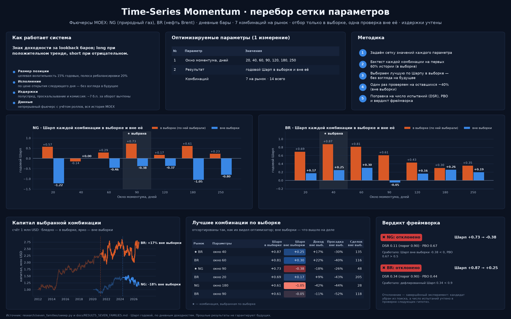
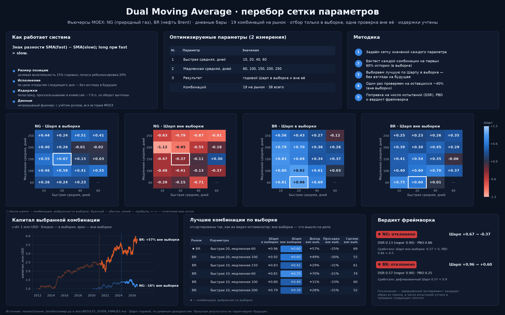
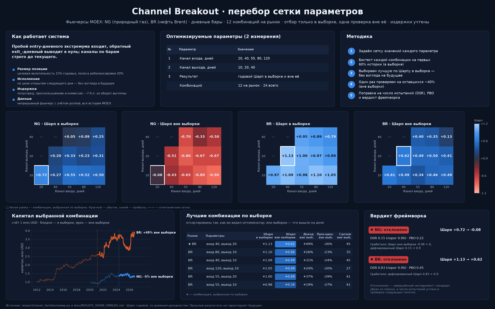
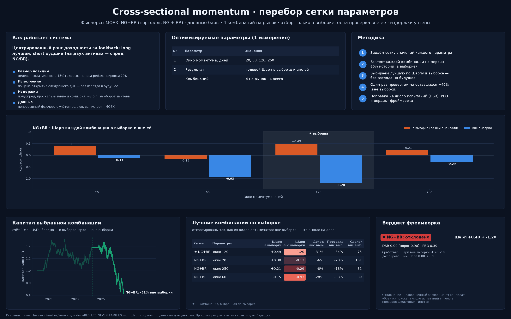
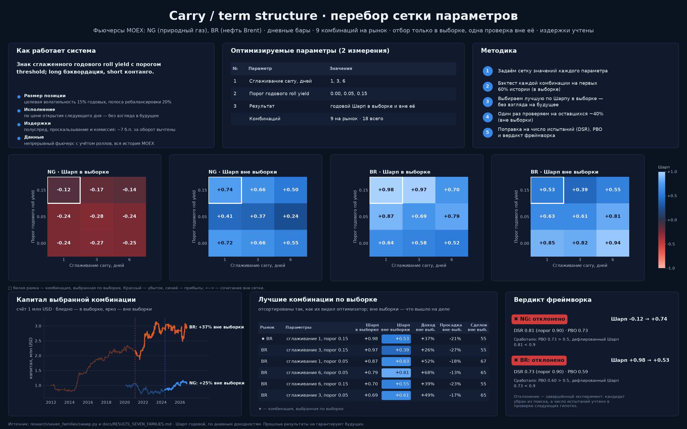
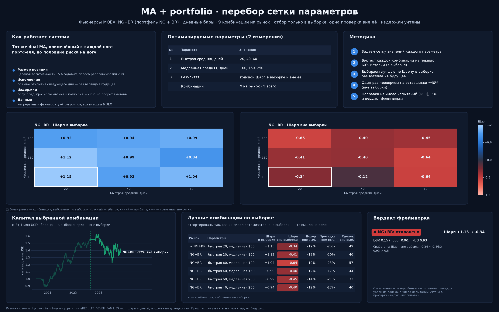
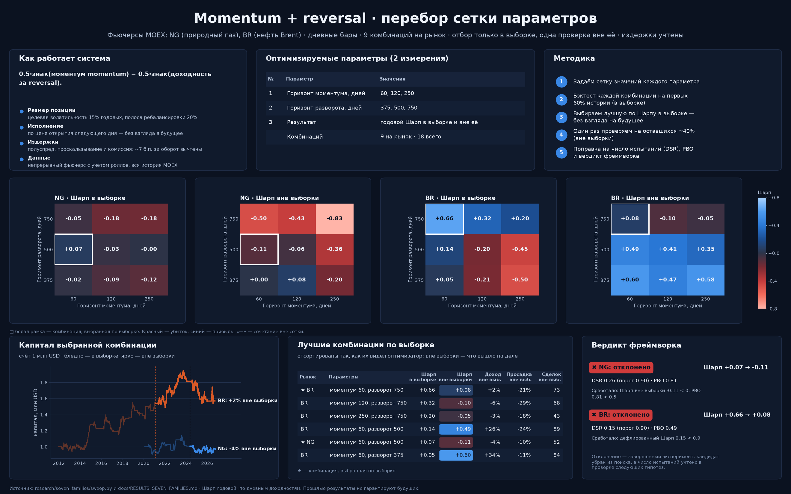
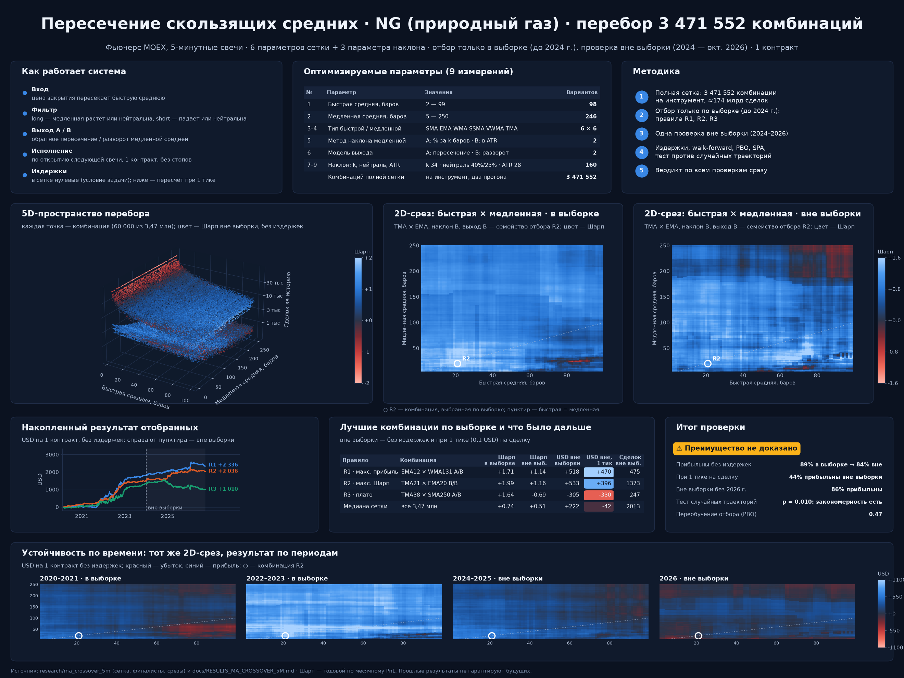
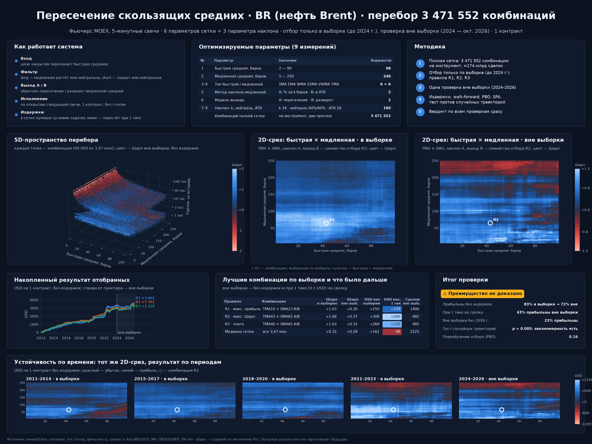

# Перебор сеток параметров: дашборды по стратегиям

По одному дашборду на стратегию: что оптимизировалось, карта перебора, лучшие комбинации по выборке и их результат вне выборки, капитал, устойчивость и вердикт проверки. Собраны `research/investor_charts/build.py` из файлов результатов репозитория.

Все числа — фактические: отбор только по выборке, результат вне выборки показан рядом; у семи семейств издержки вычтены, у скользящих средних сетка без издержек (условие задачи), а пересчёт при 1 тике на сделку дан в таблице.

## Time-Series Momentum

## Dual Moving Average

## Channel Breakout

## Cross-sectional momentum

## Carry / term structure

## MA + portfolio

## Momentum + reversal

## Пересечение скользящих средних · NG

## Пересечение скользящих средних · BR

