# Пересечение цены с быстрой MA + фильтр наклона медленной MA: 5-минутные фьючерсы MOEX

Исследование стратегии «цена пересекает быструю скользящую среднюю, направление сделки разрешает наклон
медленной средней» на всех инструментах AlgoPack (NG, BR, WTI, GOLD, SILV, COPPER, PLT, PLD), 5-минутные
свечи, вся доступная история по 2026-10-13. На каждый инструмент проверено около 9 млн конфигураций:
все 36 сочетаний шести типов средних, периоды Fast 2–99 и Slow 5–250, два метода наклона, две модели
выхода и подбор параметров наклона.

## 1. Главное

**Устойчивого торгового преимущества у конкретных параметров не найдено.** Найдены несколько воспроизводимых
закономерностей, но ни одна конфигурация не проходит поправку на множественное тестирование, а лучшие
по обучающей выборке на независимой выборке в среднем не лучше случайно взятой конфигурации из той же
сетки.

1. **Результат определяет режим рынка, а не параметры.** Одни и те же правила зарабатывают или теряют
   почти всей сеткой сразу. На золоте и серебре в IS (2012–2022) 98–100 % конфигураций с выходом по
   обратному пересечению убыточны, а в OOS (2022–2026) 67–78 % прибыльны; у PLT и PLD — наоборот. Средний
   медианный OOS t разных инструментов различается на 2,9, а 36 сочетаний типов средних внутри инструмента —
   на 0,7–1,1.
2. **Выход по смене наклона медленной MA (модель B) лучше выхода по обратному пересечению (модель A).**
   Медианный t выше на IS на всех 7 рабочих инструментах и на OOS на 6 из 7 (кроме NG). Все финалисты
   используют модель B. Быстрые входы-выходы на 5-минутках систематически проигрывают: у COPPER модель A
   убыточна у 100 % конфигураций на IS и 99 % на OOS, у GOLD и SILV — у 98–100 % на IS.
3. **Главный параметр фильтра — горизонт наклона k, а не ширина нейтральной зоны.** Медианный IS t по
   всем инструментам растёт с −1,08 при k = 1 до +0,11 при k = 80 (≈ 7 часов) и падает до −0,35 при
   k = 160; порог ε почти не влияет (−0,37…−0,46). Метод A (в %) и метод B (в ATR) после подбора
   практически равноценны: медианы OOS t различаются на 0,00–0,11, кроме BR (0,31 против 0,06).
4. **Типы средних — эффект второго порядка.** Лучшие сочетания (медленная EMA с быстрой TMA, VWMA или SMA)
   дают средний по инструментам медианный OOS t 0,34–0,40, худшие (быстрая SSMA с медленной SMA или TMA) —
   около −0,1. Медленные EMA, SSMA и WMA немного лучше медленных SMA, TMA и VWMA.
5. **Лучшие по IS конфигурации на OOS:** прибыльны на всех 7 рабочих инструментах (у COPPER — всего
   16 сделок), но OOS t всего 0,09–1,38. После поправки Холма значимых нет (минимум p = 0,58). Из 990 лучших конфигураций групп
   ни одна не проходит FDR 5 % (минимальный q = 0,082). Максимальный IS t-плато (≈ 4,2) ниже ожидаемого
   максимума при 9 млн нулевых тестов (≈ 5,3).
6. **Walk-forward (ежегодный переотбор) даёт положительный совокупный результат на всех 6 инструментах
   с длинной историей.** После поправки Холма значимы NG и PLT (p = 0,028). Отобранная конфигурация в
   среднем оказывается на 65-м перцентиле всех конфигураций тестового года (z = 4,2). Относительный ранг
   конфигураций частично сохраняется, но заметная часть результата — общий дрейф трендовых конфигураций
   в эти годы.
7. **Межрыночно** ни одна конфигурация, отобранная только по IS сразу на всех рынках, не остаётся
   положительной на OOS везде: лучшие дают плюс на 3–6 рынках из 7, средний OOS t 0,2–0,5.
8. **Экономически преимущество хрупкое**: средняя OOS-сделка финалистов NG, BR и SILV — 0,5–1,8 тика,
   издержки в 1–2 тика на круг съедят большую её часть или всю (комиссии и проскальзывание по ТЗ не
   учитывались).

## 2. Данные

Источник — `data/raw/moex_algopack`: ряд склеен по ближайшей экспирации и пропорционально скорректирован
на каждом переходе по цене нового контракта к цене старого в одну и ту же минуту. Поэтому роллирование не
создаёт ни пересечений, ни изменений наклона, то есть искусственных сигналов нет.

| Инструмент   | 5m баров   | Начало     | Конец      | Граница IS/OOS   |   USD за 1 пункт |   Тик |
|:-------------|:-----------|:-----------|:-----------|:-----------------|-----------------:|------:|
| NG           | 282 539    | 2020-02-03 | 2026-10-13 | 2025-02-07       |           100    | 0.001 |
| BR (Brent)   | 607 705    | 2011-12-19 | 2026-10-13 | 2022-11-03       |            10    | 0.01  |
| WTI (CL)     | 2 181      | 2026-07-14 | 2026-10-13 | 2026-09-28       |            10    | 0.01  |
| GOLD (GC)    | 614 498    | 2011-12-19 | 2026-10-13 | 2022-10-24       |             1    | 0.1   |
| SILV (SI)    | 564 537    | 2011-12-19 | 2026-10-13 | 2023-02-27       |            10    | 0.01  |
| COPPER (HG)  | 62 325     | 2024-10-08 | 2026-10-13 | 2026-05-29       |             0.01 | 1     |
| PLT (PL)     | 331 877    | 2011-12-19 | 2026-10-13 | 2024-07-17       |             1    | 0.1   |
| PLD (PA)     | 237 104    | 2011-12-19 | 2026-10-13 | 2025-04-25       |             1    | 0.01  |

* IS — первые 70 % баров каждого инструмента, OOS — последние 30 %. Сделка относится к периоду, в котором
  она закрыта, поэтому отбор на IS не видит ни одной цены после границы.
* Денежный PnL — в долларах США на один контракт: изменение *сырой* цены удерживаемого контракта × размер
  контракта (текущая спецификация MOEX; для COPPER цена за тонну, контракт 10 кг). Позиция, переживающая
  ролл, перекладывается в новый контракт по цене перекрытия, без скачка.
* Объём есть у каждой свечи (5-минутка существует только при сделках), поэтому VWMA определена везде и
  ни одна комбинация не исключена.
* Средние считаются по барам, а не по времени: ночные и выходные паузы не заполняются.
* **WTI (CL)** торгуется на MOEX с июля 2026 — 2 181 бар; результаты приведены, но в выводах, поправках и
  межрыночной проверке он не участвует. **COPPER (HG)** — два года истории: без walk-forward и PBO.

## 3. Методология

### 3.1 Скользящие средние (период n, цена x = Close)

| Тип | Формула | Инициализация |
|---|---|---|
| SMA | (1/n) Σ x[t−i], i = 0…n−1 | первое значение на баре n−1 |
| EMA | e[t] = a·x[t] + (1−a)·e[t−1], a = 2/(n+1) | e[n−1] = SMA(n), как в TA-Lib |
| WMA | Σ (n−i)·x[t−i] / (n(n+1)/2), свежий бар с весом n | первое значение на баре n−1 |
| SSMA | s[t] = (s[t−1]·(n−1) + x[t]) / n — сглаженная (Wilder/SMMA), то же, что EMA с a = 1/n | s[n−1] = SMA(n) |
| VWMA | Σ x·v / Σ v за n баров, v — фактический объём | первое значение на баре n−1 |
| TMA | SMA(SMA(x, ⌈n/2⌉), ⌊n/2⌋+1) — треугольные веса 1, 2, …, пик, …, 2, 1 ровно на n барах | первое значение на баре n−1 |

ATR — по Уайлдеру: SSMA истинного диапазона TR = max(H−L, |H−C₋₁|, |L−C₋₁|), TR₀ = H−L. Все формулы
проверены тестами против независимых реализаций (`tests/test_ma_slope.py`).

### 3.2 Сигналы и правила

* **Сторона цены** — sign(Close − FastMA); при равенстве сохраняется предыдущая сторона, поэтому пересечения
  строго чередуются. Пересечение снизу вверх — смена стороны с −1 на +1 на двух последовательных закрытых
  свечах (сверху вниз — наоборот). Исполнение — по Open следующей свечи.
* **Наклон Slow MA за k баров**: метод A — `(MA[t] − MA[t−k]) / MA[t−k] × 100`, метод B —
  `(MA[t] − MA[t−k]) / ATR[t]`. Состояние UP при наклоне > ε, DOWN при < −ε, иначе NEUTRAL. Пока MA[t−k] или
  ATR не определены, входов нет.
* **Вход**: long — пересечение вверх при UP или NEUTRAL; short — пересечение вниз при DOWN или NEUTRAL; только
  без открытой позиции.
* **Выход A** (`reverse_cross`) — обратное пересечение Fast MA. **Выход B** (`slope_flip`) — первая свеча
  после входа, на которой наклон стал противоположным; переход в NEUTRAL позицию не закрывает.
* Одна позиция, 1 контракт, без комиссий, проскальзывания, стопов и тейков. Разворот на свече выхода запрещён:
  следующий вход — только по новому пересечению на более поздней свече. Позиция, открытая на конец данных,
  не учитывается.

### 3.3 Пространство поиска и этапы

Базовое пространство на инструмент — ровно 98 × 246 × 36 × 2 × 2 = **3 471 552** конфигурации (Fast 2–99,
Slow 5–250, все 36 пар типов, оба метода наклона, обе модели выхода). Сюда входят случаи Fast ≥ Slow
(656 640 конфигураций, 19 %), они выделены в категорию `fast>=slow`. Полное произведение с сеткой
параметров наклона — 222 млн конфигураций на инструмент (98 × 246 × 36 × 2 × 128), около 4 суток счёта
по всем инструментам на доступных 4 ядрах. Поэтому оптимизация поэтапная:

1. **Этап 1 — полная базовая сетка** при заранее зафиксированных параметрах наклона: k = 10, ε_A = 0,02 %,
   ε_B = 0,25 при ATR(14). Значения выбраны до любого бэктеста по доле нейтральных баров на IS (10–35 % для
   EMA20…EMA250), без взгляда на доходность.
2. **Этап 2 — оптимизация наклона** на логарифмической решётке периодов (Fast: 2, 3, 4, 5, 6, 8, 10, 13, 16,
   20, 25, 32, 40, 50, 63, 79, 99; Slow: 5, 7, 10, 14, 20, 28, 40, 56, 80, 113, 160, 226, 250), все 36 пар
   типов и обе модели выхода, 128 настроек: k ∈ {1, 3, 5, 10, 20, 40, 80, 160}; метод A —
   ε ∈ {0; 0,005; 0,01; 0,02; 0,05; 0,1} %; метод B — ATR ∈ {14, 100}, ε ∈ {0,05; 0,1; 0,25; 0,5; 1,0}.
   ε = 0 у обоих методов даёт один и тот же знак изменения и учтён один раз. Для каждого инструмента и
   каждой пары «метод × модель выхода» выбрана настройка с наибольшей **медианой IS t** по решётке, то есть
   та, что улучшает типичную конфигурацию, а не одну.
3. **Этап 3 — снова полная сетка** (3 471 552 конфигурации) с выбранной на этапе 2 настройкой наклона для
   каждой пары «метод × модель». Это основной результат; этап 1 — контрольный.

**Изменения плана, зафиксированные по ходу:**
* Первая версия этапа 2 перебирала k до 40, и почти все IS-оптимумы оказались на этой границе. Сетка
  расширена до k = 80 и 160 (этап 2b) до запуска этапа 3. После расширения выбранные k равны 40 или 80, то
  есть лежат внутри диапазона. Исключение — COPPER и WTI, где выбор упирается в нижнюю границу k = 1.
* Sharpe, Sortino и просадка по рыночной оценке считаются только для отобранных конфигураций: рыночная
  оценка капитала для 3,5 млн конфигураций на инструмент вычислительно неподъёмна. В полной сетке
  просадка считается по закрытым сделкам.

Всего на инструмент с длинной историей проверено 8 979 840 конфигураций.

### 3.4 Метрики

Для каждой конфигурации, отдельно на IS, OOS и всей истории:
* чистый PnL (USD) и число сделок;
* доля прибыльных сделок и Profit Factor;
* средняя сделка, средняя прибыль и средний убыток;
* максимальная просадка закрытого капитала и максимальная серия убытков;
* средняя продолжительность сделки в барах и часах;
* доля и PnL длинных сделок;
* PnL по календарным годам.

Основная мера качества — **t-статистика средней сделки** `t = mean / sd · √n`: она не зависит от размера
контракта и учитывает число сделок.

Для отобранных конфигураций дополнительно через VectorBT считаются:
* кривая капитала по рыночной оценке;
* Sharpe и Sortino дневного PnL одного контракта — без капитала: при фиксированном размере отношение от
  капитала не зависит; годовой пересчёт по фактическому числу торговых дней;
* просадка по рыночной оценке;
* PnL по месяцам и годам.

### 3.5 Отбор и проверка устойчивости

* **Отбор не по максимальной прибыли.** Конфигурация оценивается по *плато*: средний IS t по соседям
  (Fast ±2, Slow ±5 при тех же типах, методе и модели). Нужно не меньше 100 IS-сделок и не меньше 80 %
  валидных соседей. Карта доли положительных соседей служит картой устойчивости.
* **OOS**: отобранные на IS конфигурации проверяются на последних 30 % баров; считается односторонний
  p-value средней сделки (OOS t считается при 30 и более сделках).
* **Множественное тестирование**: поправка Холма по финалистам инструментов; Benjamini–Hochberg по
  лучшим конфигурациям 144 групп (тип Fast × тип Slow × метод × выход); ожидаемый максимум t среди N
  независимых нулевых тестов как ориентир для IS; PBO.
* **Walk-forward**: окно 3 календарных года → тест на следующем году; отбор по тому же плато на обучающем
  окне среди всех 3,47 млн конфигураций. Для этапа 3 тестовые годы до границы IS/OOS не вполне чистые
  (наклон выбран на IS), поэтому основной walk-forward — по этапу 1.
* **Польза отбора**: перцентиль отобранной конфигурации среди всех конфигураций того же тестового периода
  (0,5 — не лучше случайной).
* **PBO (CSCV, Bailey et al.)**: годы разбиты на 10 блоков (у NG — на 6); для всех 252 (20) разбиений
  «половина на половину» лучшая по t конфигурация первой половины ранжируется по t второй. PBO — доля
  разбиений, где она оказалась ниже медианы. Это мера *относительного* переобучения отбора, а не
  прибыльности.
* **Monte Carlo**: 10 000 бутстрэп-перевыборок сделок финалиста (IS и OOS отдельно) — распределение
  итогового PnL, вероятность убытка, распределение максимальной просадки.
* **Межрыночная проверка** — на сетке этапа 1, где правила для всех инструментов одинаковы:
  * число инструментов с положительным OOS t для каждой конфигурации против гипотезы независимости
    (пуассон-биномиальное распределение);
  * честный отбор только по IS по худшему из рынков;
  * перенос лучшей по IS конфигурации одного рынка на остальные.

### 3.6 Проверка корректности

Ядро симуляции (numba, событийное) сверено с побарным симулятором, написанным прямо по правилам, и с
`vectorbt.Portfolio.from_signals` (`upon_opposite_entry="ignore"`, исполнение по Open следующей свечи).
Совпадают все сделки, расхождение PnL — порядка 10⁻¹³ USD (столбец `vbt_trade_pnl_max_abs_diff` в
`tables/finalists.csv` равен нулю для всех финалистов).

## 4. Результаты

### 4.1 Вся сетка: режим рынка важнее параметров

Медианы по всем конфигурациям этапа 3 (обе категории, оба метода):

| Инструмент   | Выход         |   IS t, медиана |   IS: доля t>0 |   OOS t, медиана |   OOS: доля t>0 |   ρ(IS,OOS) |
|:-------------|:--------------|----------------:|---------------:|-----------------:|----------------:|------------:|
| NG           | reverse_cross |            1.06 |           0.78 |             0.87 |            0.84 |        0.31 |
| NG           | slope_flip    |            1.59 |           0.97 |             0.57 |            0.79 |       -0.18 |
| BR (Brent)   | reverse_cross |            1.1  |           0.82 |            -0.4  |            0.27 |        0.29 |
| BR (Brent)   | slope_flip    |            2.12 |           0.99 |             0.77 |            0.88 |        0.1  |
| GOLD (GC)    | reverse_cross |           -1.53 |           0.02 |             0.74 |            0.78 |        0.47 |
| GOLD (GC)    | slope_flip    |            0.47 |           0.79 |             1.96 |            1    |       -0.1  |
| SILV (SI)    | reverse_cross |           -3.36 |           0    |             0.31 |            0.67 |        0.37 |
| SILV (SI)    | slope_flip    |           -0.02 |           0.47 |             1.34 |            0.97 |       -0.04 |
| PLT (PL)     | reverse_cross |            1.93 |           1    |            -0.75 |            0.09 |       -0.03 |
| PLT (PL)     | slope_flip    |            2.25 |           1    |             0.03 |            0.51 |        0.53 |
| PLD (PA)     | reverse_cross |            1.34 |           0.95 |            -0.28 |            0.37 |        0.37 |
| PLD (PA)     | slope_flip    |            2    |           0.98 |            -0.03 |            0.5  |        0.69 |
| COPPER (HG)  | reverse_cross |           -2.85 |           0    |            -1.56 |            0.01 |       -0.04 |
| COPPER (HG)  | slope_flip    |           -0.77 |           0.19 |             0.15 |            0.58 |        0.15 |

Знак результата меняется вместе с периодом сразу у всей сетки: золото и серебро проигрывают на IS и
выигрывают на OOS, PLT и PLD — наоборот. Ранговая корреляция IS и OOS по всей сетке (рис.
`is_vs_oos.png`) составляет 0,38–0,63 у BR, GOLD, SILV, PLT и PLD: какие семейства конфигураций лучше
других, сохраняется, а абсолютный уровень — нет.

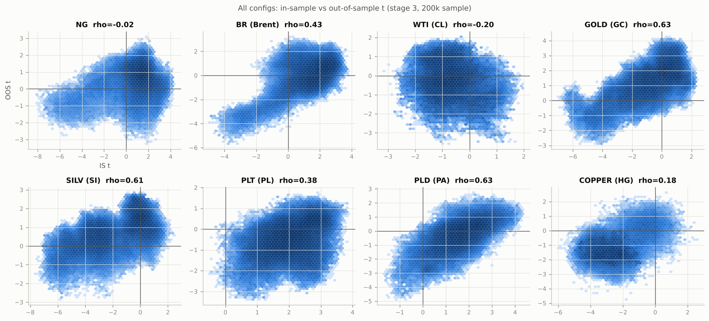

### 4.2 Сравнение 36 сочетаний типов средних

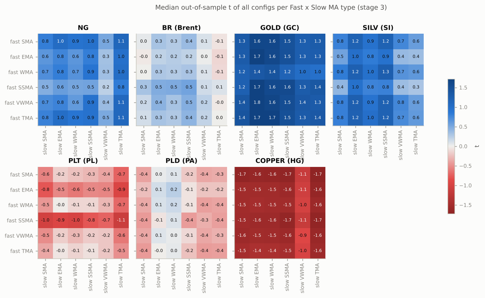

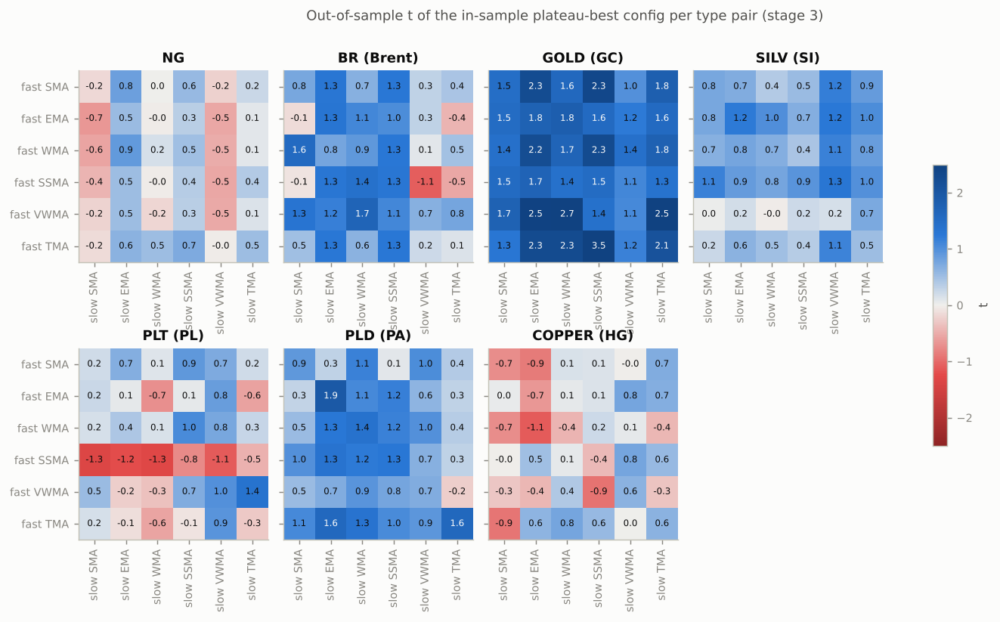

Внутри инструмента медианы 36 сочетаний различаются на 0,7–1,1, тогда как средние уровни инструментов —
на 2,9.
Средний по рабочим инструментам медианный OOS t лучших сочетаний:

* TMA → EMA: 0,40;
* VWMA → EMA: 0,37;
* SMA → EMA: 0,34;
* TMA → WMA: 0,33;
* WMA → EMA: 0,33.

Худшие: SSMA → TMA (−0,09) и SSMA → SMA (−0,08). Главные эффекты: медленная EMA (0,31), SSMA и WMA (0,24)
лучше медленных SMA (0,04), TMA (0,00) и VWMA (0,08); быстрые TMA (0,24) и VWMA (0,21) лучше быстрых SSMA
(0,03) и EMA (0,10). Полная таблица — `tables/type_pairs.csv`.

### 4.3 Модели выхода

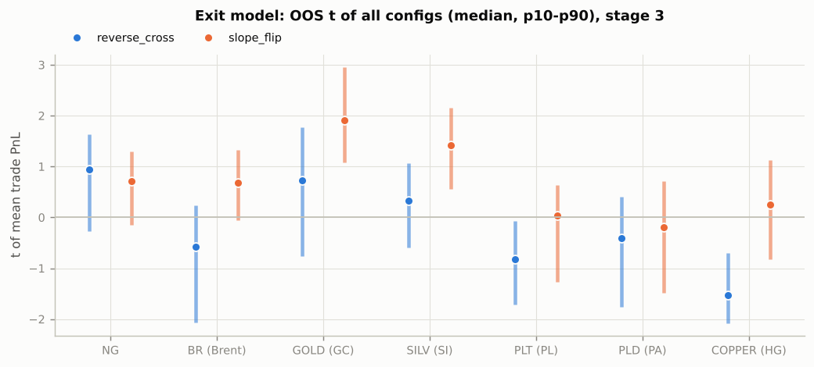

Выход по смене наклона (B) лучше обратного пересечения (A):
* по медиане IS — на всех 7 рабочих инструментах;
* по медиане OOS — на 6 из 7 (NG: 0,57 против 0,87);
* у лучших конфигураций групп доля положительных OOS — 60–100 % против 0–90 %.

Модель A — частые сделки длиной в несколько часов — систематически убыточна там, где 5-минутные цены
возвращаются к среднему: COPPER, а на IS — GOLD и SILV. Рисунок IS — `figures/exit_models_is.png`.

### 4.4 Методы определения наклона

| Инструмент   |   OOS t медиана, pct |   доля OOS t>0, pct |   OOS t медиана, atr |   доля OOS t>0, atr |
|:-------------|---------------------:|--------------------:|---------------------:|--------------------:|
| NG           |                 0.71 |                0.81 |                 0.73 |                0.82 |
| BR (Brent)   |                 0.31 |                0.62 |                 0.06 |                0.53 |
| GOLD (GC)    |                 1.34 |                0.89 |                 1.36 |                0.88 |
| SILV (SI)    |                 0.84 |                0.82 |                 0.81 |                0.82 |
| PLT (PL)     |                -0.33 |                0.32 |                -0.39 |                0.29 |
| PLD (PA)     |                -0.15 |                0.43 |                -0.15 |                0.43 |
| COPPER (HG)  |                -1.27 |                0.1  |                -1.38 |                0.07 |

После подбора методы A и B практически равноценны. Метод B даёт сопоставимую ширину нейтральной зоны на
разных рынках (это удобно при переносе), но по эффективности не выигрывает.

**Подбор параметров наклона на IS (этап 2):**

| Инструмент   | Метод   | Выход         | Выбор на IS         | IS медиана t: выбор / база   | OOS медиана t: выбор / база   |
|:-------------|:--------|:--------------|:--------------------|:-----------------------------|:------------------------------|
| NG           | atr     | reverse_cross | k=40, ε=0.05·ATR14  | -0.43 / -0.96                | -0.15 / 0.12                  |
| NG           | atr     | slope_flip    | k=40, ε=0.05·ATR14  | 2.25 / 1.44                  | 0.14 / 0.61                   |
| NG           | pct     | reverse_cross | k=40, ε=0%          | -0.43 / -0.97                | -0.16 / -0.05                 |
| NG           | pct     | slope_flip    | k=40, ε=0%          | 2.29 / 1.49                  | 0.12 / 0.58                   |
| BR (Brent)   | atr     | reverse_cross | k=40, ε=1·ATR14     | 0.14 / -0.27                 | -1.00 / -1.40                 |
| BR (Brent)   | atr     | slope_flip    | k=40, ε=0.25·ATR100 | 2.27 / 1.38                  | 1.00 / 0.41                   |
| BR (Brent)   | pct     | reverse_cross | k=40, ε=0.1%        | 0.09 / -0.22                 | -0.72 / -1.30                 |
| BR (Brent)   | pct     | slope_flip    | k=40, ε=0.1%        | 2.26 / 1.63                  | 1.13 / 0.62                   |
| GOLD (GC)    | atr     | reverse_cross | k=80, ε=0.05·ATR100 | -2.66 / -2.84                | -0.18 / -0.76                 |
| GOLD (GC)    | atr     | slope_flip    | k=80, ε=1·ATR14     | 0.87 / -0.38                 | 1.99 / 1.01                   |
| GOLD (GC)    | pct     | reverse_cross | k=80, ε=0%          | -2.67 / -2.83                | -0.17 / -0.65                 |
| GOLD (GC)    | pct     | slope_flip    | k=80, ε=0.1%        | 0.90 / -0.46                 | 2.40 / 1.16                   |
| SILV (SI)    | atr     | reverse_cross | k=40, ε=0.05·ATR14  | -4.59 / -4.78                | -0.44 / -0.45                 |
| SILV (SI)    | atr     | slope_flip    | k=80, ε=0.5·ATR14   | 0.36 / -0.95                 | 1.04 / 0.58                   |
| SILV (SI)    | pct     | reverse_cross | k=40, ε=0.02%       | -4.59 / -4.76                | -0.47 / -0.26                 |
| SILV (SI)    | pct     | slope_flip    | k=80, ε=0%          | 0.30 / -1.05                 | 1.11 / 0.94                   |
| PLT (PL)     | atr     | reverse_cross | k=80, ε=0.05·ATR100 | 2.02 / 1.74                  | -0.92 / -1.04                 |
| PLT (PL)     | atr     | slope_flip    | k=80, ε=1·ATR14     | 2.68 / 1.89                  | 0.36 / -0.10                  |
| PLT (PL)     | pct     | reverse_cross | k=80, ε=0%          | 2.03 / 1.80                  | -0.92 / -1.06                 |
| PLT (PL)     | pct     | slope_flip    | k=80, ε=0%          | 2.66 / 1.83                  | 0.40 / -0.10                  |
| PLD (PA)     | atr     | reverse_cross | k=40, ε=0.05·ATR100 | 1.41 / 1.06                  | -0.86 / -1.00                 |
| PLD (PA)     | atr     | slope_flip    | k=40, ε=0.05·ATR14  | 2.41 / 1.76                  | 0.51 / 0.02                   |
| PLD (PA)     | pct     | reverse_cross | k=40, ε=0.01%       | 1.42 / 1.21                  | -0.85 / -0.91                 |
| PLD (PA)     | pct     | slope_flip    | k=40, ε=0.01%       | 2.42 / 1.97                  | 0.50 / 0.09                   |
| COPPER (HG)  | atr     | reverse_cross | k=1, ε=1·ATR14      | -2.90 / -3.47                | -1.36 / -1.72                 |
| COPPER (HG)  | atr     | slope_flip    | k=1, ε=1·ATR100     | -0.39 / -2.02                | 0.11 / -1.15                  |
| COPPER (HG)  | pct     | reverse_cross | k=80, ε=0.005%      | -3.03 / -3.43                | -1.65 / -1.78                 |
| COPPER (HG)  | pct     | slope_flip    | k=1, ε=0.1%         | -0.67 / -1.99                | -0.18 / -1.25                 |

Выбранная на IS настройка улучшила медианный OOS t в 23 из 28 случаев (в одном — лишь на 0,01) и ухудшила
в 5: все четыре случая NG и SILV с методом A и выходом A. У NG улучшение на IS не перенеслось на OOS. Горизонт k = 40–80 баров (3–7 часов) лучше базовых
k = 10 почти везде; ширина нейтральной зоны почти не важна (рис. `figures/slope_sweep_*.png`).

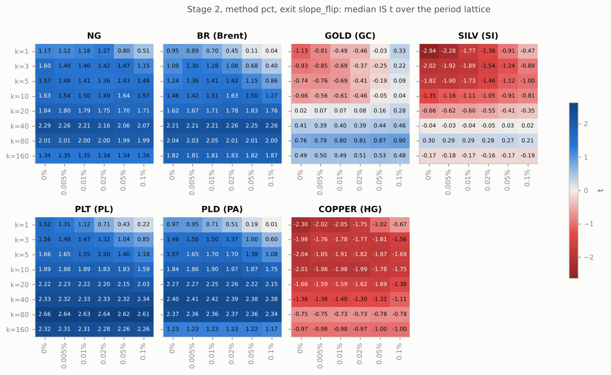

### 4.5 Категория Fast ≥ Slow

| Инструмент   |   IS t, fast<slow |   OOS t, fast<slow |   IS t, fast>=slow |   OOS t, fast>=slow |
|:-------------|------------------:|-------------------:|-------------------:|--------------------:|
| NG           |              1.29 |               0.83 |               1.47 |                0.27 |
| BR (Brent)   |              1.72 |               0.05 |               1.17 |                0.77 |
| GOLD (GC)    |             -0.61 |               1.31 |              -0.18 |                1.51 |
| SILV (SI)    |             -1.83 |               0.88 |              -1.08 |                0.61 |
| PLT (PL)     |              2.03 |              -0.39 |               2.35 |               -0.22 |
| PLD (PA)     |              1.55 |              -0.3  |               2.2  |                0.5  |
| COPPER (HG)  |             -2.7  |              -1.32 |              -2.08 |               -1.33 |

«Перевёрнутые» конфигурации (Fast ≥ Slow) не хуже стандартных: фильтр наклона медленной средней и
выход B работают одинаково при любом соотношении периодов. Устойчивой разницы между категориями нет.
Лучшие конфигурации каждой категории — в `tables/finalists.csv` (теги `fast<slow`, `fast>=slow`).

### 4.6 Рейтинг и лучшие параметры по инструментам

Лучшая по IS-плато конфигурация каждого инструмента (этап 3):

| Инструмент   | Fast   | Slow    | Наклон                    | Выход         |   IS сделок | IS t (плато)   |   OOS сделок |   OOS PnL, $ |   OOS PF |   OOS t | p (Холм)     |   OOS ср. сделка, тиков |
|:-------------|:-------|:--------|:--------------------------|:--------------|------------:|:---------------|-------------:|-------------:|---------:|--------:|:-------------|------------------------:|
| NG           | VWMA21 | EMA42   | pct k=40 eps=0%           | slope_flip    |        2033 | 4.08 (4.19)    |          911 |          156 |     1.07 |    0.53 | 0.299 (0.93) |                     1.7 |
| BR (Brent)   | WMA91  | VWMA200 | atr k=40 eps=0.25 atr=100 | slope_flip    |        1694 | 3.82 (3.68)    |          785 |           43 |     1.01 |    0.09 | 0.464 (0.93) |                     0.5 |
| GOLD (GC)    | SSMA61 | VWMA206 | pct k=80 eps=0.1%         | slope_flip    |        1132 | 2.30 (2.26)    |          480 |         1355 |     1.2  |    1.08 | 0.139 (0.84) |                    28.2 |
| SILV (SI)    | VWMA98 | TMA25   | pct k=80 eps=0%           | slope_flip    |        3360 | 2.14 (2.27)    |         1389 |          256 |     1.12 |    0.73 | 0.232 (0.93) |                     1.8 |
| PLT (PL)     | TMA20  | VWMA112 | pct k=80 eps=0%           | slope_flip    |        1231 | 3.81 (3.74)    |          588 |          965 |     1.16 |    0.95 | 0.172 (0.86) |                    16.4 |
| PLD (PA)     | WMA73  | WMA50   | pct k=40 eps=0.01%        | slope_flip    |        1699 | 4.29 (4.22)    |          690 |          943 |     1.22 |    1.38 | 0.083 (0.58) |                   136.6 |
| COPPER (HG)  | VWMA16 | WMA16   | pct k=1 eps=0.1%          | slope_flip    |         143 | 1.39 (1.63)    |           16 |            5 |     1.31 |    0.4  | 0.347 (0.93) |                    30.4 |
| WTI (CL)     | TMA7   | VWMA7   | atr k=20 eps=0.05 atr=14  | reverse_cross |         142 | 1.22 (1.41)    |           56 |          -57 |     0.75 |   -0.82 | 0.793 (—)    |                   -10.1 |

| Инструмент   |   Win% OOS | Ср. прибыль / убыток OOS, $   | Ср. длит., ч (IS/OOS)   |   Макс. серия убытков OOS | Просадка OOS (закр./MTM), $   | Sharpe IS/OOS   | Sortino IS/OOS   |   MC: P(убыток OOS) | MC: PnL OOS p5–p95, $   |   MC: просадка p95, $ |
|:-------------|-----------:|:------------------------------|:------------------------|--------------------------:|:------------------------------|:----------------|:-----------------|--------------------:|:------------------------|----------------------:|
| NG           |         32 | 7.69 / -3.36                  | 17.7 / 13.1             |                        14 | 285 / 286                     | 1.95 / 0.39     | 3.52 / 0.52      |                0.3  | -310 … 657              |                   495 |
| BR (Brent)   |         34 | 14.61 / -7.58                 | 45.1 / 34.4             |                        11 | 685 / 686                     | 1.13 / 0.02     | 1.87 / 0.03      |                0.47 | -718 … 833              |                   987 |
| GOLD (GC)    |         35 | 47.42 / -21.63                | 64.9 / 55.2             |                        13 | 837 / 935                     | 0.65 / 0.55     | 1.07 / 0.92      |                0.14 | -656 … 3464             |                  1663 |
| SILV (SI)    |         36 | 4.96 / -2.48                  | 14.6 / 11.3             |                        11 | 280 / 280                     | 0.65 / 0.31     | 1.10 / 0.63      |                0.24 | -288 … 868              |                   510 |
| PLT (PL)     |         39 | 30.42 / -16.85                | 82.3 / 30.8             |                        11 | 532 / 578                     | 1.19 / 0.57     | 1.84 / 0.93      |                0.18 | -647 … 2714             |                  1408 |
| PLD (PA)     |         39 | 19.77 / -10.18                | 42.4 / 10.9             |                        12 | 458 / 473                     | 1.20 / 1.17     | 2.26 / 1.87      |                0.08 | -151 … 2051             |                   856 |
| COPPER (HG)  |         56 | 2.30 / -2.27                  | 94.6 / 195.6            |                         3 | 8 / 11                        | 1.18 / 0.50     | 1.88 / 0.68      |                0.35 | -14 … 24                |                    19 |
| WTI (CL)     |         41 | 7.22 / -6.75                  | 5.0 / 2.3               |                         4 | 70 / 64                       | 2.28 / -4.16    | 3.68 / -5.33     |                0.8  | -170 … 58               |                   188 |

Общий профиль — классический трендовый: около 35 % прибыльных сделок, средняя прибыль примерно вдвое
больше среднего убытка. Sharpe на OOS ниже, чем на IS, у всех; почти не изменился только у PLD (1,20 → 1,17).

Полный рейтинг лучших конфигураций всех 144 групп (тип Fast × тип Slow × метод × выход) по каждому
инструменту — `tables/ranking_group_bests.csv` (отсортирован по IS-плато, содержит все метрики IS, OOS и
всей истории, p-value и q-value BH).

**Карты Fast × Slow и устойчивости** для слоя лучшей конфигурации (IS t, плато, доля положительных
соседей, OOS t): `figures/heatmap_stage3_<инструмент>.png`; для этапа 1 — `heatmap_stage1_*`. Пример
PLD:

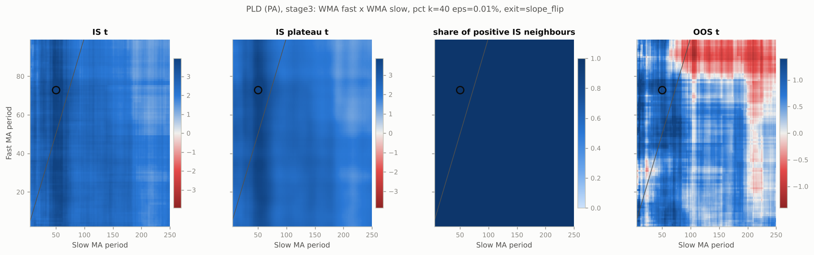

**Кривые капитала** (рыночная оценка, 1 контракт, вертикальная линия — граница IS/OOS) и распределения
сделок:

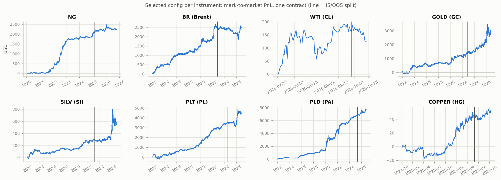

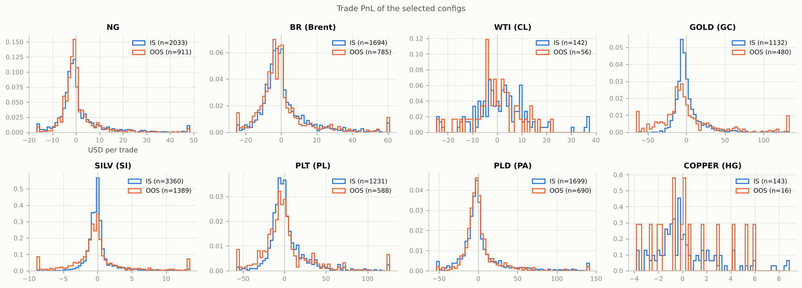

PnL лучших конфигураций по годам (USD на контракт, по времени выхода; помесячно —
`tables/finalist_monthly_pnl.csv`, сделки — `tables/finalist_trades/`):

| Год | NG | BR | GOLD | SILV | PLT | PLD | COPPER |
|---|---:|---:|---:|---:|---:|---:|---:|
| 2011 | | −3 | 30 | 11 | | | |
| 2012 | | 358 | −54 | 85 | −77 | 159 | |
| 2013 | | 146 | 530 | 1 | 273 | 8 | |
| 2014 | | 86 | −78 | −27 | 103 | | |
| 2015 | | 414 | 162 | 19 | 257 | 427 | |
| 2016 | | 85 | −52 | 28 | 135 | 190 | |
| 2017 | | 81 | 91 | 37 | 92 | 22 | |
| 2018 | | 118 | 46 | −31 | 163 | 195 | |
| 2019 | | 212 | −38 | 21 | 491 | 330 | |
| 2020 | 33 | 224 | 460 | 50 | 564 | 1 744 | |
| 2021 | 199 | 230 | 48 | 60 | 717 | 1 426 | |
| 2022 | 1 399 | 459 | 270 | 50 | 197 | 1 027 | |
| 2023 | 145 | 27 | 105 | −6 | 457 | 367 | |
| 2024 | 216 | −90 | 385 | −11 | 110 | 784 | −9 |
| 2025 | 309 | −198 | 373 | 137 | 132 | 872 | 32 |
| 2026 | −83 | 335 | 510 | 123 | 813 | 173 | 25 |

### 4.7 Независимая выборка: что сохранилось

| Инструмент   |   OOS t, этап 1 (k=10) |   OOS t, этап 3 (наклон с IS) |
|:-------------|-----------------------:|------------------------------:|
| NG           |                   0.08 |                          0.53 |
| BR (Brent)   |                  -0.18 |                          0.09 |
| GOLD (GC)    |                   0.05 |                          1.08 |
| SILV (SI)    |                   1.46 |                          0.73 |
| PLT (PL)     |                   0.39 |                          0.95 |
| PLD (PA)     |                   0.1  |                          1.38 |
| COPPER (HG)  |                  -0.25 |                          0.4  |

**С положительным результатом на независимой выборке** (этап 3, лучшая конфигурация инструмента):
* NG — VWMA21/EMA42;
* BR — WMA91/VWMA200;
* GOLD — SSMA61/VWMA206;
* SILV — VWMA98/TMA25;
* PLT — TMA20/VWMA112;
* PLD — WMA73/WMA50;
* COPPER — VWMA16/WMA16 (всего 16 OOS-сделок).

Ни одна не значима после поправки Холма. Значимой на OOS без поправки (p < 0,1) была только PLD (p = 0,083).

Из 990 лучших конфигураций групп положительны на OOS 646 (65 %), с p < 0,05 без поправки — 57 (из них
45 на золоте, где на OOS прибыльна почти вся сетка). После Benjamini–Hochberg ни одна не значима на уровне
5 %. На уровне 10 % проходят четыре конфигурации золота с выходом B и очень быстрой средней: SMA3 или TMA3
с EMA56 и SSMA30, OOS t ≈ 3,4, q = 0,082.

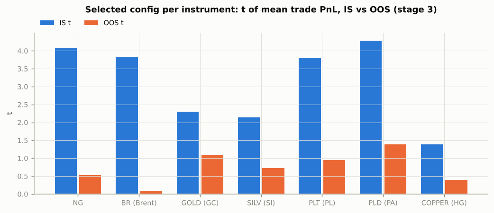

### 4.8 Устойчивость: walk-forward, польза отбора, PBO, Monte Carlo

**Walk-forward** (3 года обучения → следующий год, выбор среди всех 3,47 млн конфигураций):

| Инструмент   |   Тестовых лет |   Лет в плюсе (этап 1) |   PnL, $ (этап 1) |   t (этап 1) | p / Холм (этап 1)   |   t (этап 3) |
|:-------------|---------------:|-----------------------:|------------------:|-------------:|:--------------------|-------------:|
| NG           |              4 |                      4 |               874 |         2.56 | 0.005 / 0.028       |         1.55 |
| BR (Brent)   |             13 |                      9 |               881 |         1.15 | 0.124 / 0.160       |         2.19 |
| GOLD (GC)    |             13 |                      6 |              1888 |         1.4  | 0.080 / 0.160       |         2.43 |
| SILV (SI)    |             13 |                      9 |               862 |         2.11 | 0.018 / 0.062       |         0.67 |
| PLT (PL)     |             13 |                     12 |              2935 |         2.6  | 0.005 / 0.028       |         1.31 |
| PLD (PA)     |             13 |                     10 |              3019 |         2.16 | 0.016 / 0.062       |         2.34 |

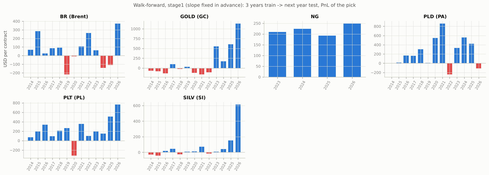

**Польза отбора** — перцентиль выбранной walk-forward конфигурации среди всех конфигураций того же
тестового года:

| Инструмент   |   Перцентиль выбора, этап 1 | t выбора / медианы, этап 1   |   Перцентиль выбора, этап 3 |
|:-------------|----------------------------:|:-----------------------------|----------------------------:|
| NG           |                        0.87 | 1.35 / 0.61                  |                        0.66 |
| BR (Brent)   |                        0.49 | 0.20 / 0.23                  |                        0.57 |
| GOLD (GC)    |                        0.58 | 0.15 / -0.20                 |                        0.7  |
| SILV (SI)    |                        0.7  | 0.20 / -0.47                 |                        0.56 |
| PLT (PL)     |                        0.74 | 1.05 / 0.45                  |                        0.52 |
| PLD (PA)     |                        0.65 | 0.89 / 0.52                  |                        0.65 |

В среднем 0,646 по 68 тестовым годам этапа 1 (z = 4,2) и 0,603 по 67 годам этапа 3 (z = 2,9). Отбор по
прошлым трём годам слабо, но статистически надёжно лучше случайной конфигурации. Однако в NG, BR, PLT и
PLD положительна и медианная конфигурация, поэтому положительный PnL walk-forward — в значительной мере общий
дрейф трендовых конфигураций.

У статического IS/OOS-финалиста перцентиль на OOS (этап 3): NG 0,38, BR 0,46, GOLD 0,37, SILV 0,45,
PLT 0,98, PLD 0,98. Только на PLT и PLD лучшая по IS конфигурация заметно лучше остальной сетки.

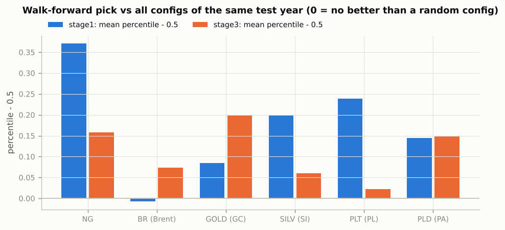

**PBO** (CSCV):

| Инструмент   |   PBO этап 1 |   PBO этап 3 |
|:-------------|-------------:|-------------:|
| NG           |         0.2  |         0.35 |
| BR (Brent)   |         0.57 |         0.53 |
| GOLD (GC)    |         0.23 |         0.24 |
| SILV (SI)    |         0.16 |         0.13 |
| PLT (PL)     |         0.45 |         0.5  |
| PLD (PA)     |         0.27 |         0.07 |

На BR и PLT отбор по лучшему t переобучен (лучшая конфигурация одной половины оказывается ниже медианы
на другой примерно в половине разбиений). На PLD, SILV, GOLD и NG ранги конфигураций сохраняются лучше
(PBO 0,07–0,35). Это согласуется с ранговыми корреляциями из раздела 4.1. Распределения логитов —
`figures/pbo_logits.png`.

**Monte Carlo** (бутстрэп OOS-сделок финалиста, таблица в разделе 4.6): вероятность убытка на OOS — от 8 %
(PLD) до 47 % (BR); 95-й перцентиль просадки в 1,4–2,7 раза больше фактической OOS-просадки.

**Множественное тестирование.** На инструмент проверено 8 979 840 конфигураций. Ожидаемый максимум t среди
стольких независимых нулевых тестов — 5,29. Лучшие IS t-плато (2,3–4,2) ниже этого порога. Сетка сильно
коррелирована, так что эффективное число тестов меньше, но и с этой оговоркой выдающихся IS-результатов
нет. Поэтому решения принимаются только по OOS, walk-forward и PBO, с поправками Холма и BH.

### 4.9 Межрыночная проверка

На сетке этапа 1 (правила одинаковы для всех рынков), 3 451 517 конфигураций, валидных на всех 7 рабочих
инструментах:

* доля конфигураций с положительным OOS t: NG 0,84, BR 0,54, GOLD 0,81, SILV 0,74, PLT 0,31, PLD 0,41,
  COPPER 0,02;
* положительны на OOS на всех семи — 5 831 конфигурация при ожидании 2 861 для независимых рынков.
  Распределение «толстое» на обоих краях (рис. ниже): конфигурации коррелируют между рынками общими
  семействами (трендовые и контртрендовые), а не одним устойчивым набором параметров;
* **честный отбор только по IS** (худший по рынкам IS t-плато): лучшие — TMA(84) как медленная и WMA(81–93)
  как быстрая, метод A, выход B. На OOS они положительны на 3–6 рынках из 7, средний OOS t 0,2–0,5
  (`tables/cross_market_is_selected.csv`). Ни одна не прибыльна на OOS на всех рынках;
* конфигурации, положительные на IS везде (57 148), на OOS чаще положительны на BR (0,93 против 0,54),
  GOLD (1,00 против 0,81), SILV (0,97 против 0,74) и PLT (0,71 против 0,31), но реже — на NG (0,73 против
  0,84) и PLD (0,38 против 0,41);
* положительны и на IS, и на OOS на всех семи рынках — 198 конфигураций. 30 лучших по минимальному OOS t
  (`tables/cross_market_robust_configs.csv`) — медленная TMA (26) или WMA (4) с периодом 76–106, быстрая
  в основном TMA или SMA с периодом 30–80, все с выходом B; минимальный OOS t по рынкам у них 0,2–0,33.
  Этот список отобран с использованием OOS, поэтому как подтверждение не засчитывается.

Перенос лучшей по IS конфигурации каждого рынка на остальные (OOS t):

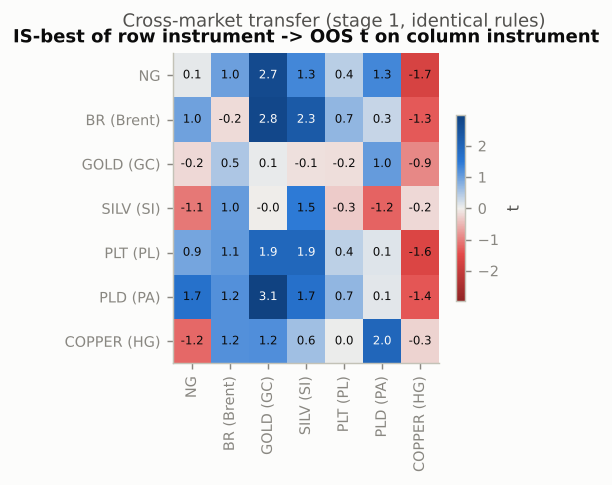

Строка — рынок, где выбрана конфигурация; столбец — где проверена. Результат определяется столбцом
(режимом рынка, на котором проверяют), а не строкой: например, на золоте положителен почти любой перенос.

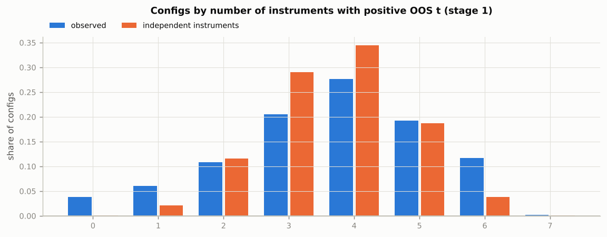

## 5. Выводы

1. **Устойчивого преимущества у конкретных параметров нет.** После учёта множественного тестирования ни
   одна из ~9 млн конфигураций на инструмент не подтверждается на независимой выборке, а лучшие по IS в
   среднем не лучше случайной конфигурации на NG, BR, GOLD и SILV.
2. **Воспроизводимые закономерности есть, и все они касаются семейств правил, а не точных чисел:**
   * удержание позиции до разворота наклона (выход B) лучше быстрого выхода по обратному пересечению;
   * горизонт наклона 40–80 баров (3–7 часов) лучше коротких;
   * ширина нейтральной зоны и метод её определения почти не важны;
   * медленная EMA, SSMA или WMA немного лучше SMA, TMA или VWMA.
   Эти выводы согласуются на IS и OOS и на большинстве рынков.
3. **Знак результата задаёт режим рынка.** Трендовые MA-стратегии на 5-минутках зарабатывали на золоте и
   серебре в 2023–2026 годах и на PLT и PLD в 2012–2024, теряли в обратные периоды. Без издержек это
   выглядит как преимущество трендовой экспозиции, но не параметров.
4. **Ежегодный переотбор (walk-forward)** дал положительный суммарный результат на всех 6 рынках с длинной
   историей; на NG и PLT он значим после поправки Холма. Это самый сильный результат исследования, но его
   заметная часть — общий трендовый дрейф. Средняя OOS-сделка на NG, BR и SILV — 0,5–2 тика, поэтому
   практическая ценность требует проверки с реальными издержками.
5. **Перед торговлей** обязательны учёт комиссии MOEX и спреда 5-минутного исполнения (особенно для COPPER и
   PLD), отдельная проверка на 2026–2027 годах как новой независимой выборке и анализ ёмкости по объёмам.
   Без этого ни одну конфигурацию нельзя считать торговой системой.

## 6. Ограничения

* Комиссии, проскальзывание и спред не учитывались (по ТЗ). Для рабочих выводов это главная оговорка.
* Размеры контрактов — по текущей спецификации MOEX; история изменений спецификаций через ISS для старых
  контрактов недоступна.
* Средние считаются по 5-минутным барам, которые существуют только при сделках: у неликвидных PLD, PLT
  (2012–2018) и COPPER бар не равен 5 минутам рынка.
* WTI исключён из выводов (2 181 бар). У COPPER всего 16 OOS-сделок у финалиста; walk-forward и PBO для него
  не считались.
* Поэтапная оптимизация (раздел 3.3) — компромисс по вычислениям. Параметры наклона подбирались на решётке
  периодов и затем фиксировались для полной сетки, а не перебирались для каждой пары периодов.
* Граница IS/OOS одна (70/30 по барам); её чувствительность частично покрывают walk-forward и CSCV.

## 7. Просмотр в Jupyter и воспроизведение

Все результаты открываются ноутбуком [`notebooks/06_ma_slope_research.ipynb`](../../notebooks/06_ma_slope_research.ipynb)
(уже выполнен, читается прямо на GitHub). Он берёт данные только из репозитория: таблицы, рисунки, полные
сетки из `grid/` и свечи AlgoPack, а в разделе «Исследователь» строит карту Fast × Slow для любого слоя и
пересчитывает любую конфигурацию через VectorBT (сделки, кривая капитала, Sharpe, Sortino, PnL по месяцам).
Пересобрать и выполнить ноутбук:

```bash
python scripts/build_ma_slope_notebook.py
python scripts/run_notebook.py notebooks/06_ma_slope_research.ipynb
```

Краткая презентация всей работы — от загрузки котировок до выводов — в
[`notebooks/07_project_presentation.ipynb`](../../notebooks/07_project_presentation.ipynb). Её ячейки размечены как
слайды, а `notebooks/07_project_presentation.slides.html` — та же презентация в виде слайдов reveal.js (открыть в
браузере, листать стрелками). Сборка:

```bash
python scripts/build_presentation_notebook.py            # рисунки overview_prices, roll_example_plt, strategy_example_ng + ноутбук
python scripts/run_notebook.py notebooks/07_project_presentation.ipynb
python scripts/build_presentation_notebook.py --slides   # слайды из выполненного ноутбука
```

Полный пересчёт исследования с нуля:

```bash
pip install -r requirements.txt && pip install -e . --no-deps
python scripts/ma_slope_research.py stage1    # полная базовая сетка, ~1,5 ч на 4 ядрах
python scripts/ma_slope_research.py stage2    # наклон k ≤ 40 на решётке, ~1 ч
python scripts/ma_slope_research.py stage2b   # наклон k = 80, 160, ~20 мин
python scripts/ma_slope_research.py stage3    # полная сетка с выбранным наклоном, ~1,5 ч
python -c "from src.ma_slope import study; study.run(); study.selection_skill()"   # анализ, ~1,5 ч
python -c "from src.ma_slope import study; study.export_all()"    # компактные полные сетки в grid/, ~25 мин
```

Этапы возобновляемые: готовые инструменты пропускаются. Сырые сетки (≈17 ГБ, `float32`, с разбивкой каждой
конфигурации по годам) пишутся в `results/ma_slope/` и в git не входят: GitHub не принимает файлы больше
100 МБ. Всё, что из них следует, лежит в репозитории: таблицы, рисунки и полные сетки в компактном виде.

**Полные сетки** (`grid/`, parquet, читаются `pandas.read_parquet`):

| Файл | Содержание |
|---|---|
| `stage3_<тикер>.parquet` | основной результат: все 3 471 552 конфигурации инструмента — типы и периоды Fast/Slow, метод наклона, модель выхода; на IS и OOS — сделки, PnL (USD), t, Profit Factor, доля прибыльных, максимальная просадка; IS-плато t. Настройки наклона — в метаданных файла (`ma_slope`) |
| `stage1_<тикер>.parquet` | то же для контрольной сетки с заранее заданным наклоном (k = 10) |
| `stage2_<тикер>.parquet` | решётка подбора наклона: 17 × 13 периодов × 36 пар типов × 2 выхода под каждой из 128 настроек (метод, k, ε, ATR) — сделки, PnL и t на IS и OOS |

Точность хранения: сделки — точно, деньги — до 0,1 USD, t и Profit Factor — до 0,01, доля прибыльных — до 0,001.

**Исходный код**: `src/ma_slope/` (`averages.py` — средние и ATR, `signals.py` — пересечения и наклон,
`kernel.py` — симулятор, `grid.py` — этапы, `analysis.py` — отбор и проверки, `finalist.py` — VectorBT и
календарь, `study.py` — анализ и рисунки, `plots.py`, `presentation.py` — рисунки и таблицы презентации),
`scripts/ma_slope_research.py`, тесты `tests/test_ma_slope.py`.

**Машиночитаемые результаты** (`tables/`):

| Файл | Содержание |
|---|---|
| `grid_summary.csv` | распределения IS/OOS t по инструменту × методу × выходу × категории, ранговая корреляция |
| `type_pairs.csv` | 36 сочетаний типов: медианы, доли, лучшая конфигурация и её OOS |
| `ranking_group_bests.csv` | рейтинг: лучшая по плато конфигурация каждой из 144 групп, все метрики, p и q (BH) |
| `finalists.csv` | лучшие конфигурации инструментов (общая и по категориям) с Sharpe, Sortino, MC, поправкой Холма |
| `finalist_trades/*.csv`, `finalist_monthly_pnl.csv`, `finalist_yearly_pnl.csv` | сделки и календарь финалистов |
| `trade_ledger.xlsx`, `trade_ledger.csv` | реестр всех 16 349 сделок финалистов этапа 3 по порядку: время, контракт и цена входа и выхода, роллы внутри сделки, PnL в $ и тиках, накопленный итог; в Excel — сводка, все сделки в порядке закрытия и лист на инструмент (итоги, просадка и серии убытков — формулы). Сборка — `python scripts/build_trade_ledger.py`, просмотр — `notebooks/08_trade_ledger.ipynb` |
| `slope_sweep.csv` | этап 2: все 128 настроек наклона × выход по инструментам |
| `walk_forward.csv`, `walk_forward_summary.csv` | выбор и результат каждого тестового года, совокупный t |
| `selection_skill.csv` | перцентиль выбора среди всех конфигураций периода |
| `pbo.csv` | PBO по CSCV |
| `cross_market_*.csv` | счётчики рынков, честный IS-отбор, конфигурации-«везде плюс», матрица переноса |
| `summary.json` | число испытаний, ожидаемый максимум t, межрыночные доли, границы IS/OOS |
